# Real vs game photo pairs (DATA-008)

A Street View photo and the same view in the game, side by side, at spots across each resort. Each pair shows what is off (terrain, rock, trees, snow, built things, far view, sky) and feeds concrete cards on the board. Card: [DATA-008 (#107)](https://github.com/drewkeriazes/SnowboardAnywhere/issues/107).

## Workflow for one spot

1. **Find a Street View spot** in Google Maps (Vail has a lot of trekker imagery on runs and at lift tops). Frame the view, then copy the full URL from the address bar. It carries `@lat,lon,3a,<fov>y,<heading>h,<tilt>t`. Note the capture date and contributor shown at the bottom of the Street View.
2. **Convert it to a game link** (from the repo root, the game dev server running on 5173):

   ```
   python tools/gmaps2game.py "<maps url>" vail --spot china-bowl-north-rim/southwest --add --name "China Bowl, rock outcrop near the north rim"
   ```

   It prints a link like `http://localhost:5173/?pack=vail&x=1421.5&y=289.6&h=218.9&pitch=-8.4&fov=63.5&cam=eye&spot=china-bowl-north-rim/southwest`. `--add` writes the view into `vail/<spot>/spot.json` (it creates the file for a new spot; fill in `streetview_capture` by hand). Without `--spot` it prints a plain link.
3. **Open the link.** The game skips the menu and opens in the eye camera at that view: 1.7 m above the ground, HUD and rider hidden, rider frozen.
   - Look: click for mouse look, or the arrow keys (Shift for faster). Walk: WASD (Shift faster). Eye height: Q / E. FOV: `[` / `]`. Street View positions can be tens of metres off, so nudge until the skyline lines up.
   - **P saves the shot** to `docs/compare/<pack>/<spot>/eye-<view>.png` through the dev server and records the pose under that view's `eye` in `spot.json`. Without `spot=` it downloads the PNG instead. The URL bar is updated to the nudged pose either way.
   - A hint with these keys shows for 10 s on load. Lift markers and piste lines are hidden. C or F leaves the eye camera (the HUD comes back); reload the link to return.
4. **Save the real photo** next to it as `real-<view>.png` for side-by-side review. It stays on your PC: `docs/compare/.gitignore` keeps `real*.png` out of git (see Licensing).
5. **Write `notes.md`** with the checklist below and link every finding to a card: a comment on an existing card with the pair, or a new BUG / FEAT / DATA card.
6. **Add the spot to the index** below.

Take the Street View screenshot and the game shot with the browser window the same size, so the two frames have the same aspect ratio.

### Re-shooting after a build

```
cd game && npx vite build && node tools/shoot_spots.mjs vail --gpu          # every spot
cd game && npx vite build && node tools/shoot_spots.mjs vail china-bowl-north-rim --gpu
```

This re-renders every view's `eye-<view>.png` headless at 1280x720 (`--size WxH` to change; the current shots are 1919x910 to match a full-width Street View window), using the saved `eye` pose if there is one, else the converted Street View pose. It waits until the terrain, mask and tree tiles have finished streaming, so shots have no half-built LOD skirts. Commit the new shots with the change that moved them, so the pair history follows the code.

### Conventions

- **Heading:** Street View headings are from true north; the game's `h` is from grid north (UTM). `gmaps2game.py` adds the grid convergence (about +0.85 degrees at Vail). `spot.json` keeps both: `heading` (true) and `h` (grid).
- **Pitch:** Street View tilt 90 is level; `pitch = tilt - 90`, negative looks down.
- **FOV:** the Maps `y` value is the vertical FOV of the Street View window, and the game's `fov` is vertical too (confirmed on the Yonder pair: a lone pine's position across three headings matched to within 5 px).
- **Wrong compass:** contributor photospheres (a person's name as author, not "Google") can have a wrong heading; the Yonder panorama is about 88 degrees off. If nothing lines up, sweep the game heading until a far landmark (a valley, a peak, a lift tower) matches, then re-add every view of that panorama with `--offset <deg>`. Name the views by their true direction.
- **Wrong position:** contributor pins can also be hundreds of metres off (the Prima panorama is pinned 540 m west, in forest). Signs: the eye camera lands in trees, or the fall line runs the wrong way. Find the real spot from things the photo fixes (fall line direction, bearings to a lift terminal or building, open ground), render the candidates, and re-add the views with `--at X,Y`.
- **Eye height:** 1.7 m by default (`--eye` / `eye=`). Trekker imagery is shot from a backpack mast at about 2 to 2.5 m, which matters only for very close foreground.

## Checklist for each pair

- **Terrain shape:** ridgelines, saddles, slope angles, gullies (DEM issues).
- **Rock:** amount for the season, colour (Vail red sandstone vs Gore grey), size and edges, snow on ledges (FEAT-069).
- **Trees:** density, clumps vs lone trees, height and shape, treeline, species and colour, aspen vs conifer (BUG-023, FEAT-070).
- **Snow:** tone, texture (corduroy, tracks, sun cups, wind ripples), shading in shadow, edges of tracks (FEAT-047, BUG-021).
- **Built things:** lift towers and terminals, buildings, signs, fences, bridges (BUG-022).
- **Far view:** horizon peaks, haze, forest colour on distant ridges (FEAT-041, FEAT-052).
- **Sky and light:** sky colour, clouds, sun direction for the capture time.

## Spot index

| Spot | Game (eye camera) | Status | Cards |
|---|---|---|---|
| [China Bowl, rock outcrop near the north rim](vail/china-bowl-north-rim/notes.md) (Mar 2018) | 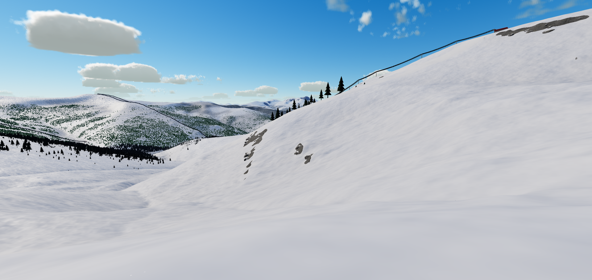 | open | [FEAT-069 #106](https://github.com/drewkeriazes/SnowboardAnywhere/issues/106), [BUG-023 #108](https://github.com/drewkeriazes/SnowboardAnywhere/issues/108) |
| [Back Bowls, top of Campbell's](vail/back-bowls-campbells/notes.md) (Jan 2019) | 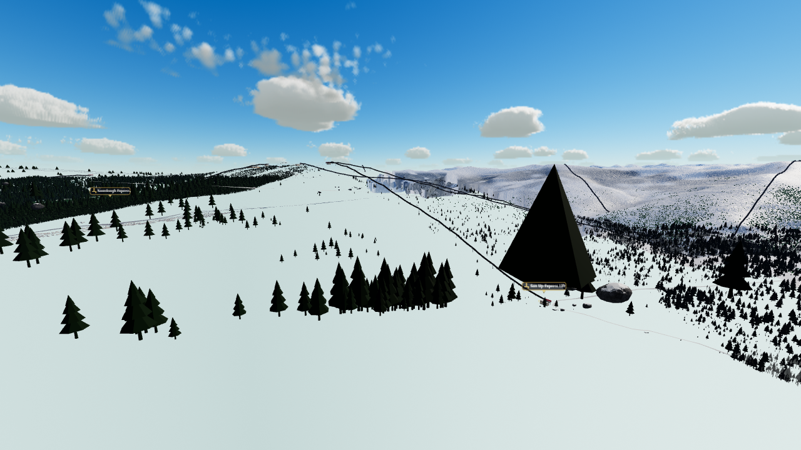 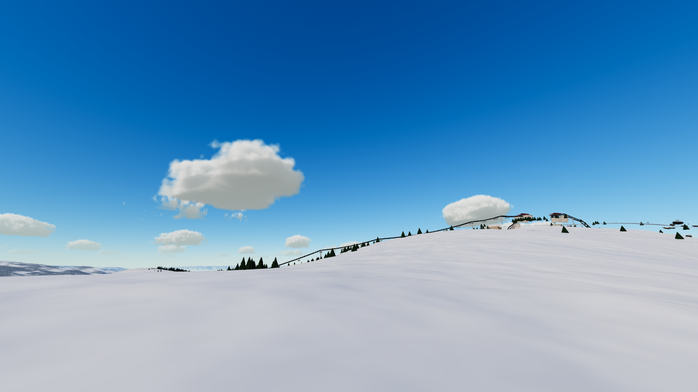 | open | [FEAT-059 #92](https://github.com/drewkeriazes/SnowboardAnywhere/issues/92), [BUG-023 #108](https://github.com/drewkeriazes/SnowboardAnywhere/issues/108), [FEAT-070 #109](https://github.com/drewkeriazes/SnowboardAnywhere/issues/109), [FEAT-069 #106](https://github.com/drewkeriazes/SnowboardAnywhere/issues/106) |
| [Back Bowls, on Yonder near Sun Up Express](vail/back-bowls-yonder/notes.md) (Feb 2014, 5 views) | 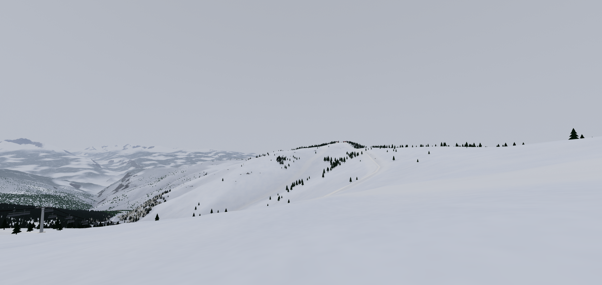 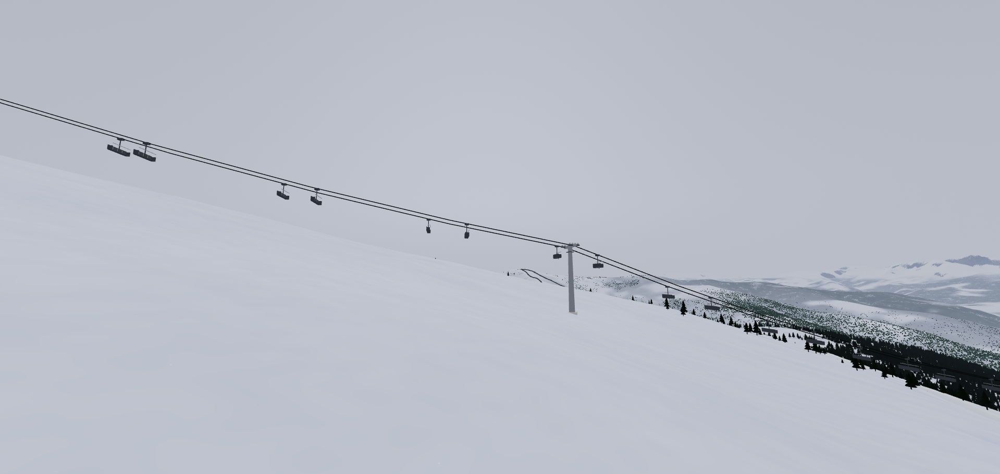 | open | [BUG-023 #108](https://github.com/drewkeriazes/SnowboardAnywhere/issues/108), [FEAT-070 #109](https://github.com/drewkeriazes/SnowboardAnywhere/issues/109) |
| [Front Side, Eagle's Nest event deck](vail/eagles-nest-deck/notes.md) (Jan 2016, 4 views) | 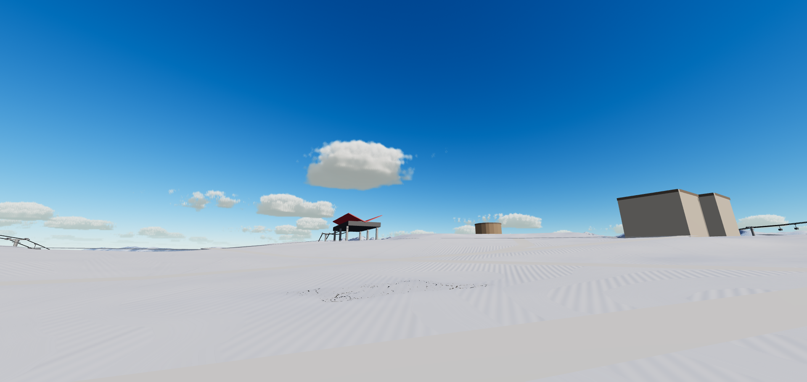 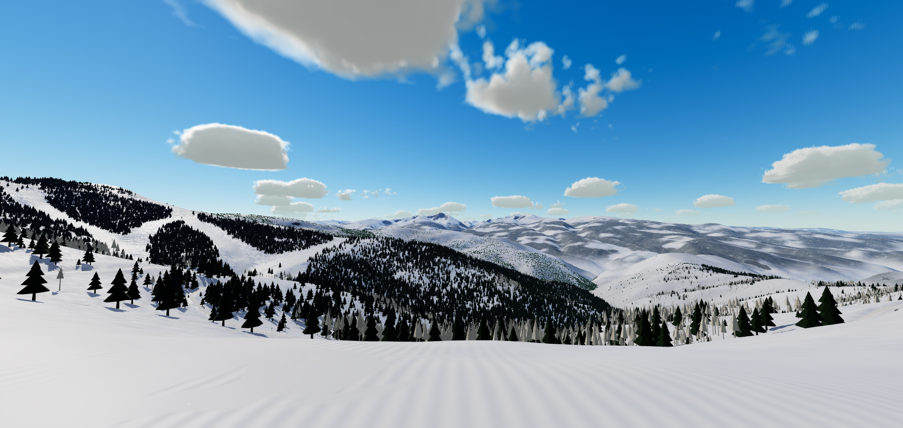 | open | [BUG-024 #110](https://github.com/drewkeriazes/SnowboardAnywhere/issues/110), [FEAT-070 #109](https://github.com/drewkeriazes/SnowboardAnywhere/issues/109), [BUG-023 #108](https://github.com/drewkeriazes/SnowboardAnywhere/issues/108) |
| [Mid-Vail, Wildwood / Mountain Top Express bottoms](vail/mid-vail-wildwood/notes.md) (Mar 2016, 4 views) | 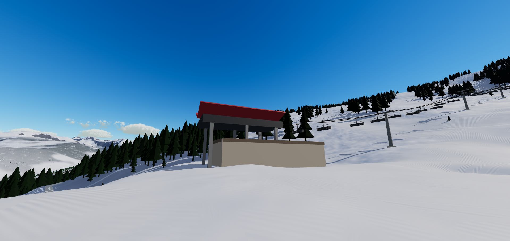 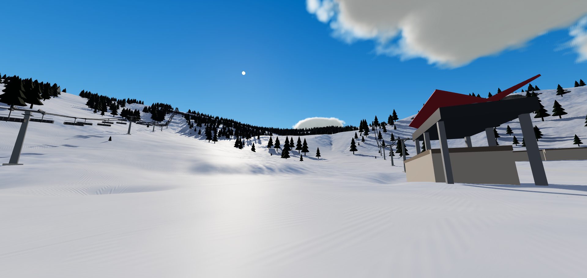 | open | [DATA-009 #112](https://github.com/drewkeriazes/SnowboardAnywhere/issues/112), [BUG-023 #108](https://github.com/drewkeriazes/SnowboardAnywhere/issues/108), [FEAT-071 #111](https://github.com/drewkeriazes/SnowboardAnywhere/issues/111) |
| [Prima, near Brown's Face](vail/prima-browns-face/notes.md) (Jan 2017, 5 views; pin 540 m off) | 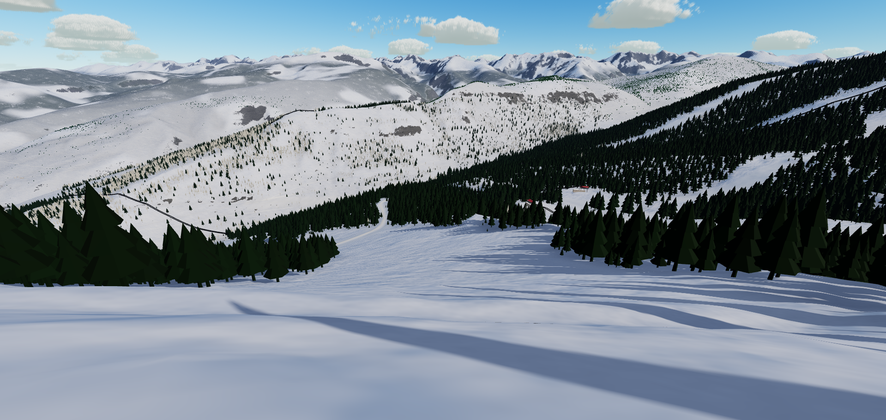 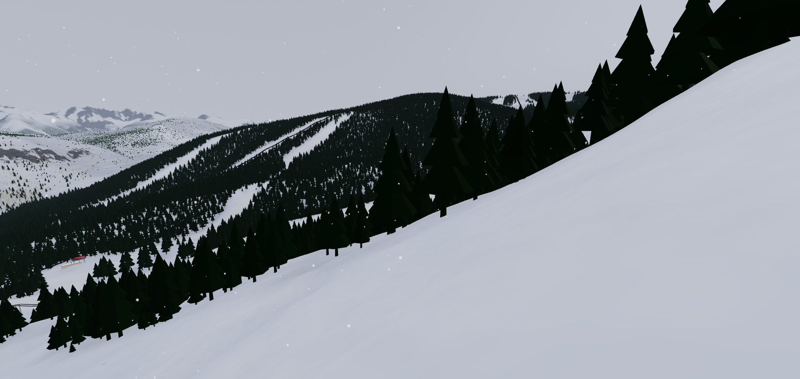 | open | [FEAT-070 #109](https://github.com/drewkeriazes/SnowboardAnywhere/issues/109), [BUG-023 #108](https://github.com/drewkeriazes/SnowboardAnywhere/issues/108), [FEAT-059 #92](https://github.com/drewkeriazes/SnowboardAnywhere/issues/92) |
| [Born Free, at the Cub's Way junction](vail/born-free/notes.md) (Mar 2012, Google trekker, 4 views) | 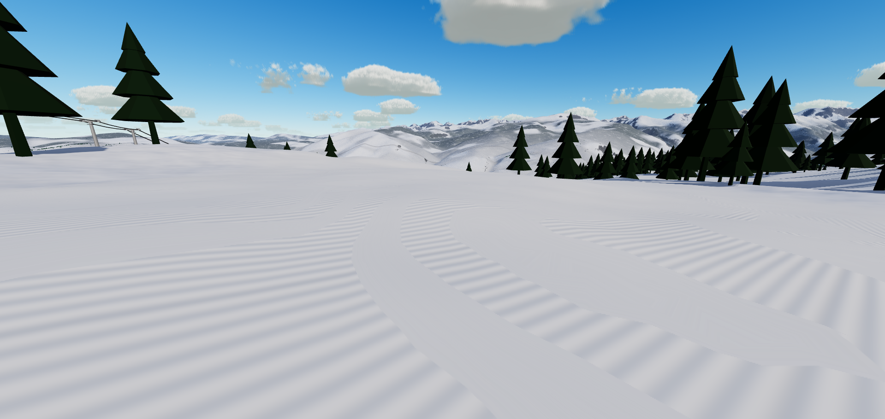 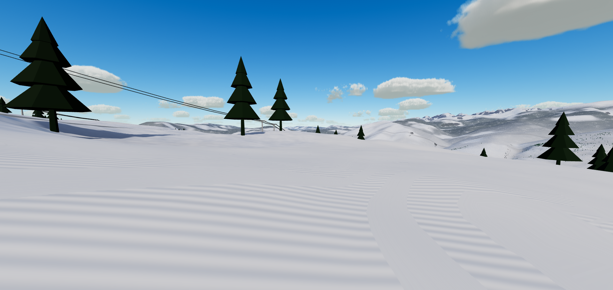 | open | [BUG-023 #108](https://github.com/drewkeriazes/SnowboardAnywhere/issues/108), [FEAT-070 #109](https://github.com/drewkeriazes/SnowboardAnywhere/issues/109) |
| [China Bowl, Poppyfields / Dragon's Teeth](vail/china-bowl-poppyfields/notes.md) (Mar 2014, 4 views; compass 105 deg off) | 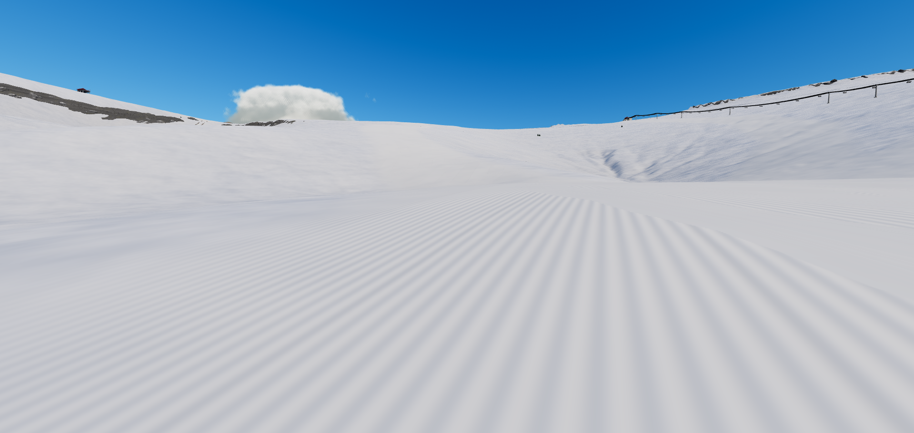 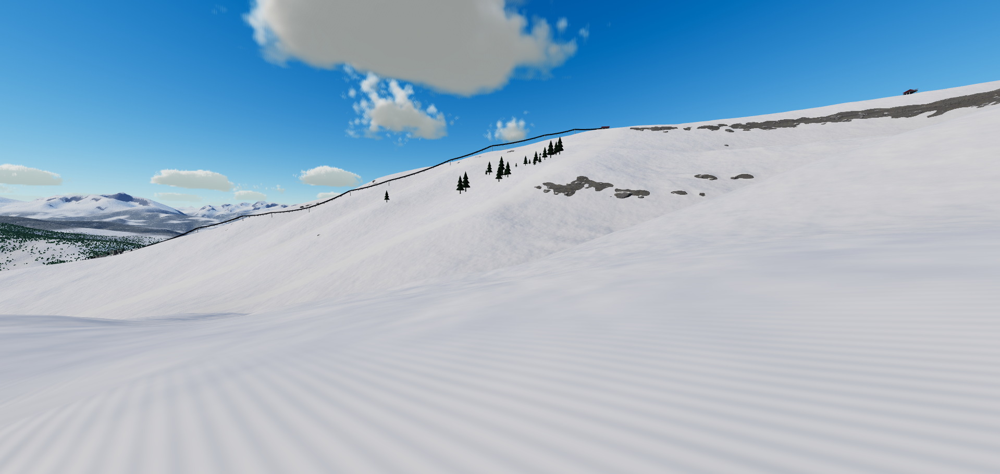 | open | [FEAT-069 #106](https://github.com/drewkeriazes/SnowboardAnywhere/issues/106), [BUG-023 #108](https://github.com/drewkeriazes/SnowboardAnywhere/issues/108) |
| [Blue Sky Basin, The Divide near Skyline Express](vail/blue-sky-the-divide/notes.md) (Mar 2023, 4 views) | 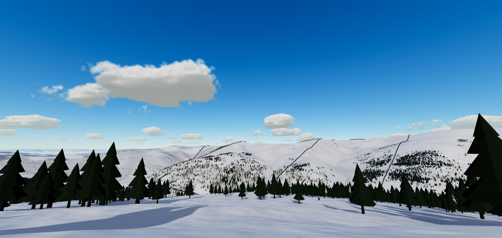 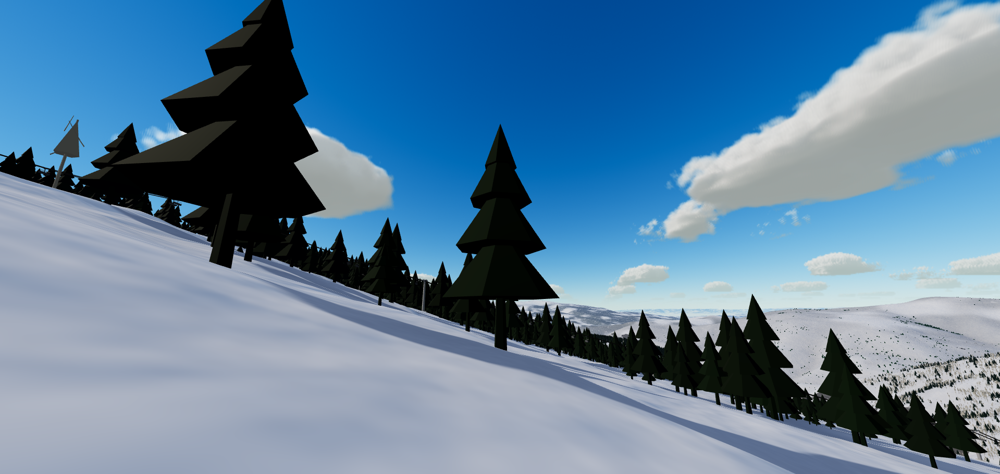 | open | [BUG-023 #108](https://github.com/drewkeriazes/SnowboardAnywhere/issues/108), [FEAT-070 #109](https://github.com/drewkeriazes/SnowboardAnywhere/issues/109) |
| [Blue Sky Basin, near In the Wuides](vail/blue-sky-in-the-wuides/notes.md) (Feb 2014, 4 views; compass 76 deg off) | 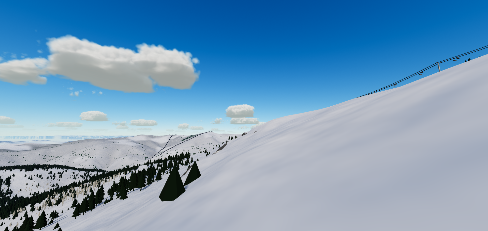 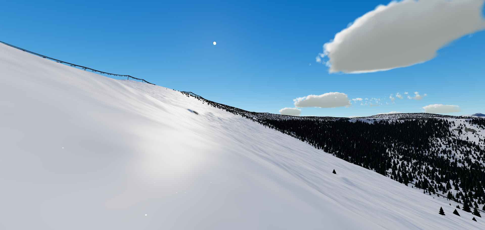 | open | [FEAT-069 #106](https://github.com/drewkeriazes/SnowboardAnywhere/issues/106), [BUG-023 #108](https://github.com/drewkeriazes/SnowboardAnywhere/issues/108), [FEAT-070 #109](https://github.com/drewkeriazes/SnowboardAnywhere/issues/109) |
| [Mongolia Bowl, above Two Elk Connector](vail/mongolia-bowl/notes.md) (Feb 2014, 4 views; compass 76 deg off) | 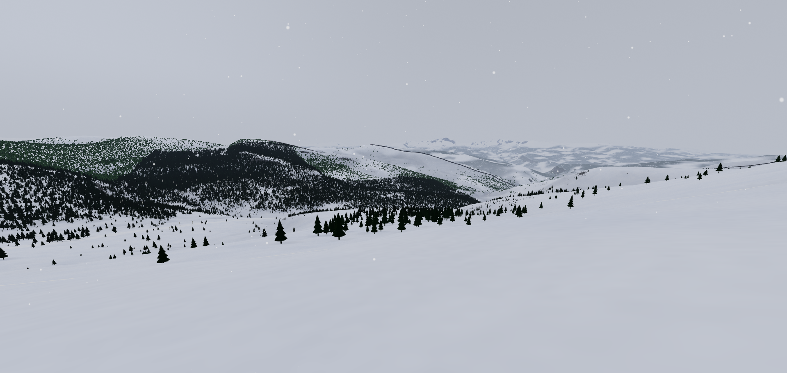 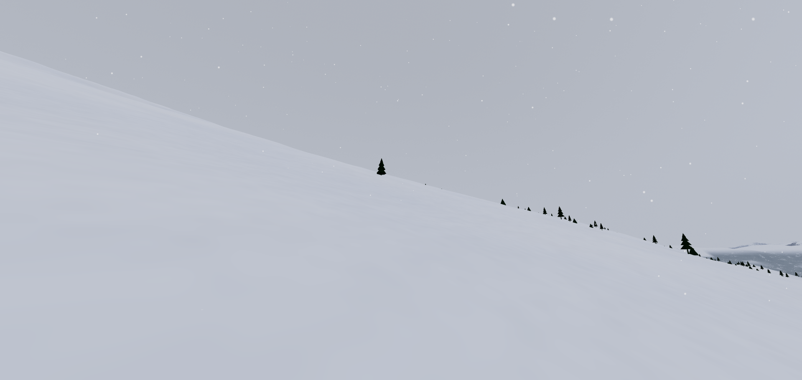 | open | [BUG-023 #108](https://github.com/drewkeriazes/SnowboardAnywhere/issues/108) |
| [Blue Sky Basin, near Pete's Express (Big Rock Park)](vail/blue-sky-petes-express/notes.md) (Mar 2012, Google trekker, 3 views) | 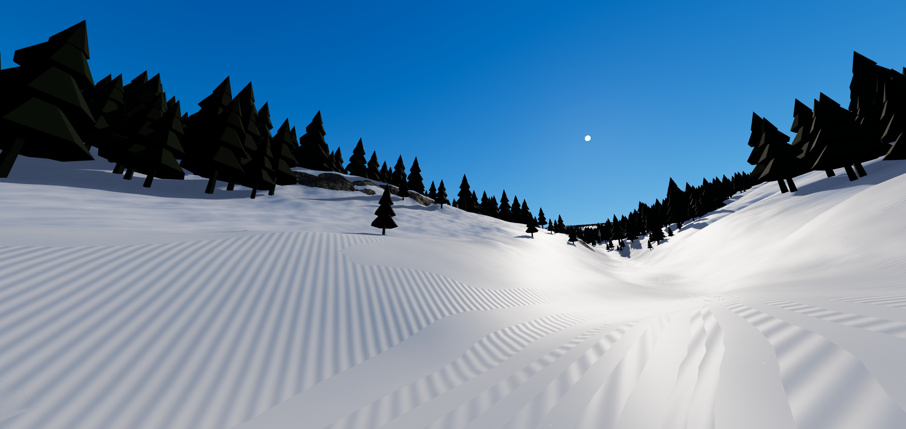 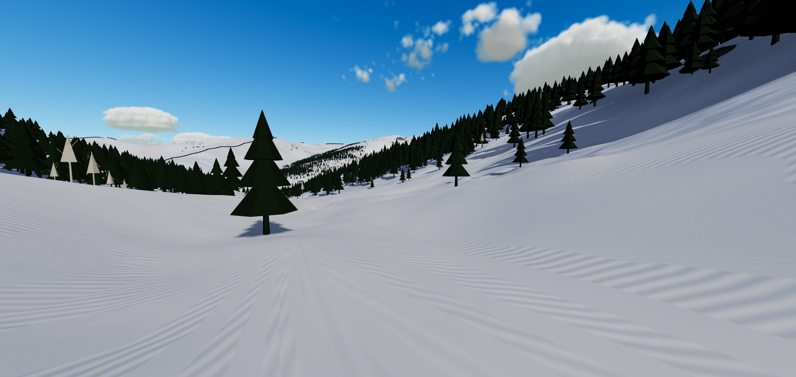 | open | [FEAT-070 #109](https://github.com/drewkeriazes/SnowboardAnywhere/issues/109), [FEAT-069 #106](https://github.com/drewkeriazes/SnowboardAnywhere/issues/106) |
| [Blue Sky Basin, Belle's Camp](vail/blue-sky-belles-camp/notes.md) (Mar 2012, Google trekker, 4 views) | 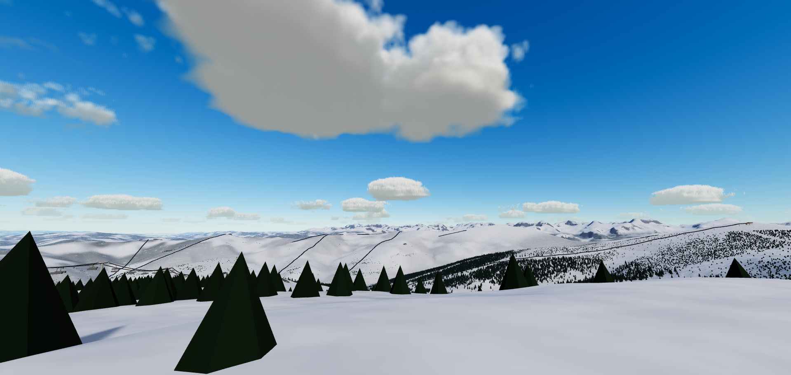 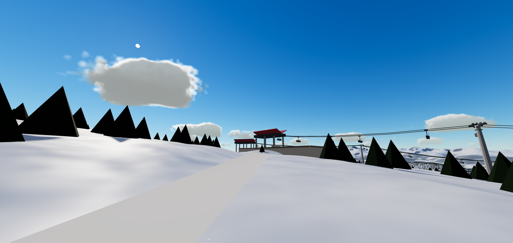 | open | BUG-025, BUG-026, [FEAT-071 #111](https://github.com/drewkeriazes/SnowboardAnywhere/issues/111) |
| [Blue Sky Basin, Hornsilver](vail/blue-sky-hornsilver/notes.md) (Feb 2014) | 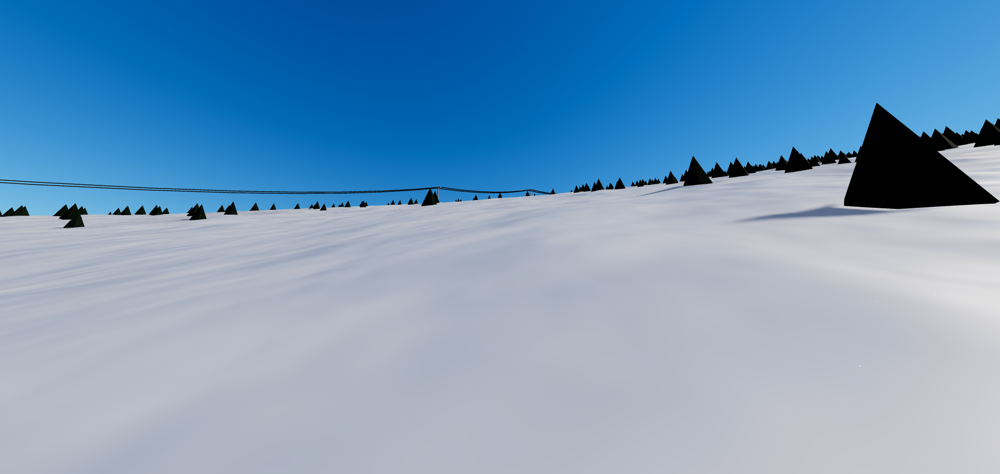 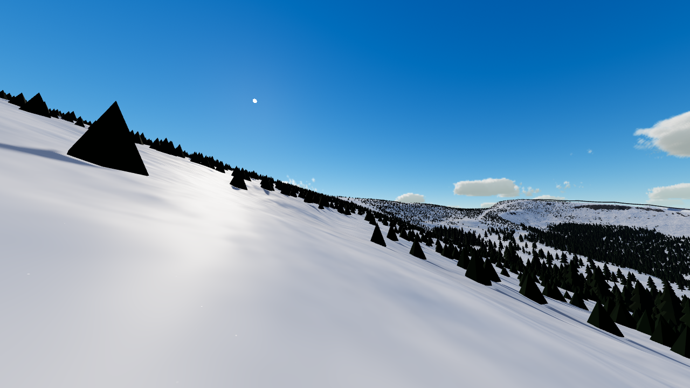 | open | [BUG-023 #108](https://github.com/drewkeriazes/SnowboardAnywhere/issues/108), [FEAT-070 #109](https://github.com/drewkeriazes/SnowboardAnywhere/issues/109), [FEAT-069 #106](https://github.com/drewkeriazes/SnowboardAnywhere/issues/106) |

Still to find (aim for 20 per resort, spread across bowls, glades, groomers, ridges and bases):
- Blue Sky Basin: China Bridge, Belle's Camp, Lover's Leap glades.
- Back Bowls: Sun Down / Sun Up ridges, Forever, Game Creek Bowl.
- Front Side: Riva Ridge, Prima Cornice (cliff rock), Lionshead base.
- Breckenridge: Imperial Bowl, Peak 8 base, T-bar.

## Licensing

Street View images are Google's and cannot be shipped or published (see DATA-005, #18), and this repo is public. `real*.png` is gitignored; `spot.json` stores the Street View URL so anyone can reopen the real view. Game screenshots are ours and are committed.
