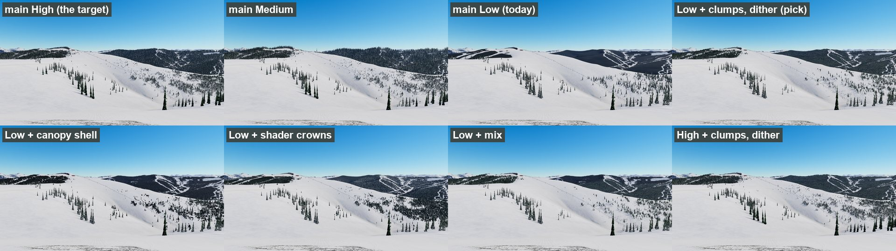
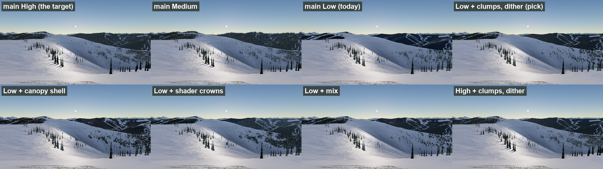
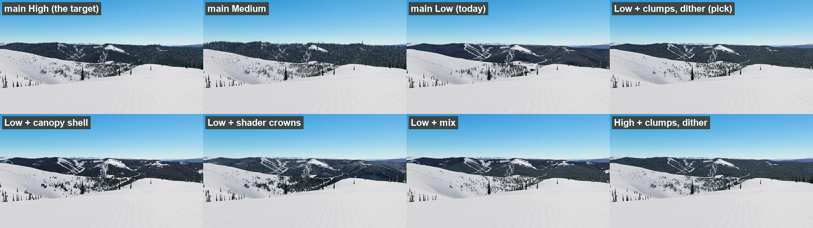
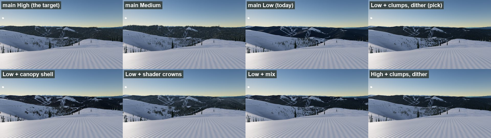
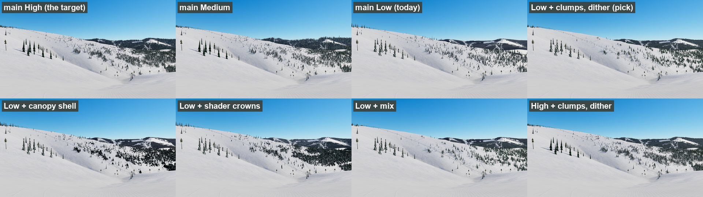
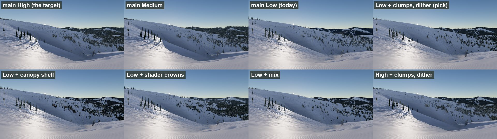
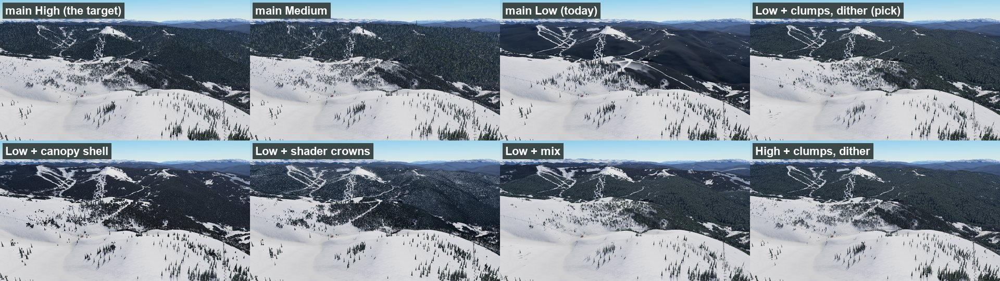
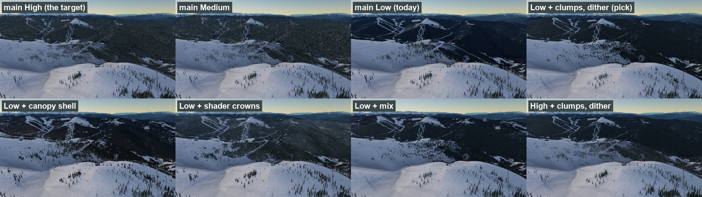

# Far forest canopy: hiding the snow like real trees (FEAT-278)

Card: [FEAT-278 (#614)](https://github.com/drewkeriazes/SnowboardAnywhere/issues/614). Related: BUG-114 (#612), BUG-074 (#417), BUG-069 (#387), FEAT-154 (#347), FEAT-184 (#434), FEAT-228 (#530), FEAT-236 (#556). Found along the way: BUG-120 (#632), BUG-121 (#633).

A research and compare card: three ways to draw dense forest at 0.6 to 6 km were prototyped on their own branches, behind a URL flag, and measured against `main` at the same poses, light and settings. Drew's review sent it round twice more: a mix of two of them by distance, then the clump impostors with a crown dither, which won. Nothing here ships; the winner gets its own build card.

## Recommendation

**Clump impostors with a crown dither** (`?canopy=clumps` on branch `issue-614-canopy-mix`, where the dither lives; Drew's pick, 2026-11-13). One camera-facing card per 64 m forest cell from where the drawn trees end out to 6 km (9 km on High), baked from the tree kit at load, thinned against the pack cover. Far off, where the baked atlas is averaged down, each pixel draws one crown (lit or shaded, snowy or bare, with the averaged chance), so the stands keep the speckle real trees make; where a crown is under about 2 px it fades back to the average, so it does not shimmer.

Why, view by view (see [Review](#review-2026-11-13) and [The mix](#the-mix)): clumps were already the best from the snow and the steadiest in motion; the dither fixed their one loss, the flat look from the air (worst at dawn). The mix (clumps, then the canopy shell past 4.5 km) was built to give the far mountains the shell's texture, but where the two met there was a hard colour line across the far ridges, and the shell's clearings were larger than High's. Dithered clumps alone have no seam, and on the far ridges they match `main` High's runs, clearings and treed skyline more closely than the shell did. Shader crowns still look best from the air but cost 3 to 9 ms.

Numbers against `main` (1080p, ground / aerial; two alternating passes per build): High 0 / -7%, Medium +1 / -1%, Low +8 / +7% (about +0.7 / +0.9 ms at the GPU's usual clocks; that run shared the GPU with other work, so read the percentages). Tree draw calls on High 525 to 460, about 40 MB less geometry. Ride clip flicker 3.96 on Low (`main` 3.87) and 4.48 on High (`main` 4.89, the steadiest of every build); pop-ins at the Low tree edge in the top-left third of the frame 7 against `main`'s 19 (BUG-121). Nothing new in the pack.

What the build card has to add (from the prototype's gaps, below): more than one species mix (one conifer stand today; species per cell from MapPacker would allow mixed stands); conservative depth so the cards keep early-Z (`gl_FragDepth` today); the bake off the load path (90 to 140 ms, synchronous); the dawn tone (still darker than High's warm-lit crowns); a slightly greener, smoother look than High's impostors past 2.5 km on High; the reach on Low and Medium (6 km; 9 km keeps the furthest ridges textured at dawn for about +0.5 ms on Low); a check of the handover and runtime setting changes in a real ride; render-budget and synth-pack coverage. Related next step, not part of this card: precomputed mountain shading at low sun (FEAT-290, #639).

## The problem

At mid distance dense forest reads as flat dark blotches. Thick forest doesn't remove the snow under it; it hides it behind crowns. Past the drawn trees the terrain paints forested ground a flat `timber` colour (`TerrainMaterial.ts`), which has no height, no uneven crown tops and no white between them. On High (Trees and Forest 100%, about 2.1M trees) it looks right, because the trees do the hiding. The Low preset draws trees only to 600 m (`setVegetationBudget(250, 600, false)`), so everything past that is the flat colour: the stills below show it as a navy slab with the ski trails cut into it. Medium scales the reach by 0.6 and looks close to High in these views.

Target look (Drew's Vail dawn photo over the Back Bowls, not committed): dense stands as 3D uneven crown tops with bits of white, sparse stands as single dark trees on white, clean snow between them.

## Views

Fixed poses in `game/tools/canopy-views.json` (pack metres, heading from grid north, vertical FOV 50 degrees). The three ground views are also compare spots in `docs/compare/vail/` (no Street View photo yet).

| View | Pose | What it shows |
|---|---|---|
| `slot-corner` (`the-slot-corner/sun-up`) | x -640, y 368, h 112, pitch -4 | Coming round the corner of The Slot toward the Sun Up Express (Drew's snips) |
| `sign-sunup` (`back-bowls-sign/over-yonder`) | x -690, y 470, h 150, pitch -5 | Just below the Legendary Back Bowls sign toward Sun Up and Over Yonder (BUG-074). At the sign itself (-736, 488) its own trees fill the frame |
| `lower-sunup` (`the-slot-lower/sun-up`) | x -360, y 171, h 125, pitch -2 | Further down The Slot; the far forested ridges on the right are the "good" reference |
| `aerial` | x -727, y 524, h 160, pitch -18, 700 m up | FEAT-154's look from above |

## Method

- **Stills:** `game/tools/canopy_compare.mjs` shoots every view per build at noon (12 h) and low sun (7.6 h), at 1920x1080 and 2560x1440, on each preset (High, Medium, Low as Settings > Graphics sets them, pixel ratio 1, Auto quality off), clear weather, Vail v4 pack, on Drew's RTX 2070 SUPER (ANGLE D3D11, headless). It waits for the tiles, trees and the candidate's own build to settle.
- **Cost:** GPU time per frame from timer queries (`EXT_disjoint_timer_query_webgl2`), median of 30 frames after a 120-frame warm-up; every build measured twice in alternating order and the lower of the two taken. Wall-clock frame times swung by up to 10 ms between identical runs on this PC (the GPU idles at 300 MHz between bursts and the desktop is in use), GPU time by about 0.4 ms; two of the eight passes were still disturbed (main's second pass on Medium and Low, crowns' first on High and Medium), which the minimum discards. Draw calls, triangles and a scene memory estimate (every geometry buffer and texture reachable from the scene, counted once) come from the same frames.
- **Handover:** `game/tools/canopy_clip.mjs` glides the eye camera 500 m down The Slot at 25 m/s looking at the middle of the Sun Up Express, Low and High, 30 fps. Two numbers from each clip, over the whole frame (decoded to 640x360): flicker, the mean temporal second difference per pixel (smooth motion mostly cancels), and pops, a 16 px block whose brightness steps between two frames while holding steady for 4 frames either side (something appeared or vanished rather than slid past), binned to a 3x3 grid of the frame. The first write-up measured only rows 25 to 60% and reported no pops; that missed the pop-ins Drew saw at the top left on Low.
- **Baselines:** `main` at each preset. `main` High is the brute-force look the card calls right.

The full set (every build, preset, view and light, 1080p frames and native-pixel 1440p crops, a full-size flip view, and the handover clips) is on the comparison page, a private claude.ai artifact: https://claude.ai/artifact/2gWCh56cdmCCSaZNAceLgA. Grids of Low with each candidate against `main`, and the dithered clumps on High (1080p, scaled):

| View | Noon | Low sun (7.6 h) |
|---|---|---|
| The Slot corner |  |  |
| Below the sign |  |  |
| Lower toward Sun Up |  |  |
| Aerial |  |  |

## The candidates

Each is on its own branch, off this card's branch, behind `?canopy=<name>`; with the flag off each behaves as `main`. All three are built on the client from what the pack already has (cover levels, the 4 m crowns map in `cover/pack-stands.png`, the tree kit). All three follow runtime Trees, Forest and Auto quality changes per frame through the Vegetation bands, with no rebuild (BUG-114); none was checked in a live Auto quality drop.

### 1. Canopy shell (`issue-614-canopy-shell`, `?canopy=shell`)

`game/src/terrain/CanopyShell.ts`: a quadtree of 64x64-quad heightfield tiles from where the drawn trees end out to 10 km, 4 m spacing near, coarser with distance. A vertex over forest stands at canopy height with jittered, uneven tops; one over open ground sinks under the snow. At 4 m a lone crown is its own cone; coarser tiles march 8 steps per pixel through a layer of procedural crown cones so grazing views see crown sides and views from above see snow between them. The terrain drops its flat `timber` under the shell, and the old canopy `lift` takes over at 8 to 10 km. `?canopyfrom=thin` starts it at the impostors' thinning radius instead (fewer tree draws on High, but it looked worse on Medium and High).

### 2. Clump impostors (`issue-614-clump-impostors`, `?canopy=clumps`)

`game/src/world/trees/clumps.ts`: at load, 8 stand patches (4 crown covers x 2 seeds, 712 of the kit's own LOD0 conifers over tilted ground) are rendered from 5 view elevations into albedo, normal plus depth, and snow plus tree-id atlases. Past where full-density trees end (Low 600 m, Medium 1.9 km, High 2.5 km) out to the far edge (6 to 9 km), one camera-facing card per 64 m forest cell picks and blends the two tiles nearest its view angle over the local slope, writes its own depth so bases sink into the terrain, and thins tree by tree against the pack cover so runs and glades cut through cleanly. All cards are one instanced draw. The per-tree impostors dissolve out over the same band, Vegetation stops loading tree cells past it, and the terrain's flat timber steps back there.

### 3. Shader-only crowns (`issue-614-shader-crowns`, `?canopy=crowns`)

`game/src/terrain/canopyCrowns.ts`, spliced into the terrain shader under a define: each 4 m cell of the tree map holds at most one jittered ellipsoid crown from a hash, sized by the canopy height (put in the trees texture's spare A channel). Per pixel the view ray is walked back cell by cell (up to 20) with front-to-back occlusion, so crowns have real parallax and a lit and a shaded side; pixels that show snow walk toward the sun for short crown shadows. Past about 1.7 km (1080p) crowns hand over to 8 m clumps, then to the old flat canopy past about 3.5 km, so the lattice never aliases into moire. Inside the drawn trees' reach it fills only the share the drawn trees leave over, so High and Medium get no double forest.

## Review (2026-11-13)

Drew went through the comparison page and the clips. The first write-up recommended clumps on the ground views and the flicker numbers; the review ranked each view on its own and reversed parts of it.

| View | Best | Worst | Notes |
|---|---|---|---|
| Ground stills, Low | clumps | `main`, shell | `main` is the flat slab; the shell's near band reads as dark cones |
| Handover clip, Low | crowns, then clumps | `main` (top left), shell (top right) | Pop-ins at the top left as the rider closes in: the drawn trees appearing at Low's 600 m edge, on `main` too (BUG-121) |
| Handover clip, High | clumps | | Smoother, less jitter, still reads 3D |
| Aerial, noon | crowns, shell | clumps | Clumps read as flat felt from above |
| Aerial, dawn (7.6 h) | crowns, then shell | clumps | Clumps barely change `main` Low's dark slab |
| Far mountains | shell | | Texture and shape, and no brown ground showing under it |

Two claims in the first write-up were wrong: shader crowns are not "too speckled and grey" from the air (they are the closest to High there), and "no pops were measured" came from a measure that only looked at rows 25 to 60% of the frame. Drew also circled grey-brown ground between the trees at 1 to 3 km on **`main` High**, the target itself; none of the candidates touches the ground under the drawn trees, so it is its own card (BUG-120, #632).

Drew's direction: combine techniques by render distance, the shell for the far mountains.

## The mix

Branch `issue-614-canopy-mix` (the clumps branch with the shell merged in), `?canopy=mix`. Both prototypes run at once: the drawn trees, then the clumps from where the trees' full density ends (Low 600 m, Medium 1.9 km, High 2.5 km) out to 4.5 km (at least 800 m and half the trees' reach past their edge), then the shell from there to 14 km (sinking over the last 2 km, where the terrain's canopy lift takes over). The shell rises over the same 300 m the clumps dissolve out over. `?clumpfar=` and `?shellfar=` move the two edges. Both read the Vegetation bands every frame, so a Trees or Forest change moves them with no rebuild. On High the mix replaces the per-tree impostors past 2.5 km (main draws them to 9 km).

What was tried on the way, on Low at the aerial and The Slot corner, noon and dawn:

1. **Handover at 2 km** (the shell from 2 km). From the air this looked right, but from the snow the slope 2 to 3 km out read as the shell's dark blobs with smooth ridgelines and trails that look too wide, where clumps alone read as trees. The shell's weak band is not only its 4 m tiles near the trees; it is any shell seen at a grazing angle within about 3 km. Starting at 2 km also saved less than expected: the shell still built 200 to 270 tiles (25 to 29 MB), because the tile count is set by the far rings, not the near ones.
2. **Why the clumps are flat from the air.** The stand atlases are baked at full size and box-filtered down the mips, so far off a pixel shows the average of many crowns: their snow, their sunlit sides and their shaded gaps blend into one dark tone. At dawn every crown gets the stand's mostly-shaded average. The shell and the crowns keep a per-crown speckle instead, which is what High's real trees make when they alias. More snow on the crowns (`?clumpsnow=0.7`) and a brighter tone (`?clumpgain=1.35`) helped little.
3. **Crown dither** (`clumps.ts`, on in the mix, `?clumpdither=0` turns it off). Where the atlas is minified, each pixel draws one crown from a hash per 4.5 m world cell: lit or shaded, snowy or bare, with the averaged value as its chance, and the needle tone varied 70 to 130%. The mean stays the same and the speckle comes back. Snowy crowns draw at 0.4 white (`?clumpspeak=`; at 0.85 they read as hard white dots). From the air the clumps now read close to High at noon; at dawn they have the texture but are still darker than High's warm-lit crowns. From the snow at dawn it also helps: the far slope at The Slot corner goes from a flat brown-dark tone to textured forest.
4. **Dither shimmer.** In the Low clip the dither raised flicker from 3.91 (clumps alone) to 4.28, as much as shader crowns: a crown cell 1 to 2 px across flips as the camera moves. It now fades back to the average where a cell is under about 2 px (`?clumpdpx0=1.2&clumpdpx1=2.5`, from the cell's screen footprint), which brought it to 3.99 (High 4.70 to 4.50) and kept the texture from the air.
5. **Handover at 4.5 km, shell to 14 km.** From the snow the clumps carry everything within 3 km, where they were best; the shell carries the far ridges and the ranges behind them.

Gaps seen in the mix: past 4.5 km the shell leaves larger white clearings than High (it reads only the detected crowns map, `cover/pack-stands.png` G, while High also draws the generated stems); the shell's ridgelines are smooth where High's have tree tops; the seam at 4.5 km was not checked in a live ride. On **High** the mix is a small step down from `main` High, the target: past 2.5 km the clumps read greener and smoother than `main`'s per-tree impostors, and past 4.5 km the shell's clearings show. The build card has to choose whether High keeps `main`'s impostors out to 9 km with the shell only past them (High looks as today; the mix's 0.5 to 1.6 ms saving there is given up), or takes the mix and fixes those two gaps.

6. **Drew's second look: the seam.** On the page (High, Below the sign, noon) the line where the clumps hand over to the shell runs as a hard colour change along the far ridges: the clumps greener and lighter, the shell a darker navy with larger white clearings. Matching the shell's tone could soften it, but the two would still differ in texture along one line.
7. **Dithered clumps alone** (`?canopy=clumps` on the mix branch: the clumps with steps 3 and 4, to 6 km, and to 9 km on High where the trees already reach that far). No seam, and on the far ridges they match `main` High's runs, clearings and treed skyline more closely than the shell (crops on the page, Below the sign). Drew confirmed the aerial reads well and picked them. Reaching 9 km on Low as well (`?clumpfar=9000`) keeps the furthest ridges textured at dawn instead of smoothing slightly, for about +0.5 ms on Low in a single pass; a choice for the build card.

So the mix is not recommended: its one strength, the far mountains, holds up better with dithered clumps, and it brings a seam, the shell's clearings and its build hitches.

## Comparison

GPU ms per frame, change against `main` at the same view and preset (lower of two passes). "Ground" is the mean of the three ground views; the aerial is its own column because forest fills most of that frame. Shell, crowns and clumps were measured in the first session; the mix in a second session and the dithered clumps in a third, each against `main` measured again in that session, alternating. The third session's GPU ran about 50% slower throughout (`main` Low ground / aerial 13.1 / 18.8 ms against 8.6 / 12.5; other work shared the machine; the two passes per build agreed within 0.1 ms), so its column gives the change in per cent and, in brackets, that per cent of the first session's `main`.

| | `main` ground / aerial | Shell | Crowns | Clumps | Mix | **Clumps + dither** (recommended) |
|---|---|---|---|---|---|---|
| High 1080p | 10.3 / 15.4 | +0.0 / +0.1 | +2.9 / +8.4 | -0.1 / -0.3 | -0.5 / -1.6 | **0% / -7% (0 / -1.0)** |
| Medium 1080p | 9.4 / 13.8 | +0.1 / +0.1 | +3.5 / +9.1 | +0.1 / -0.1 | +0.1 / -0.2 | **+1% / -1% (+0.1 / -0.2)** |
| Low 1080p | 8.6 / 12.5 | +0.2 / +0.2 | +3.3 / +8.3 | +0.6 / +0.5 | -0.3 / +0.8 | **+8% / +7% (+0.7 / +0.9)** |
| High 1440p | 14.6 / 22.1 | -0.1 / +0.1 | +5.2 / +14.9 | +0.0 / -1.4 | -0.7 / -2.2 | **+1% / -6% (+0.1 / -1.3)** |
| Medium 1440p | 13.4 / 19.9 | +0.3 / +0.1 | +5.1 / +14.0 | +0.6 / +0.1 | +0.1 / -0.5 | **+2% / -1% (+0.3 / -0.2)** |
| Low 1440p | 12.5 / 18.1 | +0.4 / +1.1 | +5.1 / +13.4 | +0.8 / +0.9 | +0.9 / +1.2 | **+9% / +8% (+1.1 / +1.5)** |

The mix's Low ground figure at 1080p (-0.3) is within the noise (one `main` pass on Low was disturbed and discarded); read it as no change. It was measured before the dither fade (step 4 above), which adds one `fwidth` per clump pixel.

| | Canopy shell | Clump impostors | Shader crowns | Mix (clumps to 4.5 km, shell past) | **Clumps + dither** (recommended) |
|---|---|---|---|---|---|
| **Looks, Low** | Big step up: speckled crown mass with white runs. From the air close to High. From the snow the 0.6 to 2 km band is dark cones and blotches with more white between than High's spires; dark and harsh at dawn | Closest to High in every view, noon and dawn: uneven crown tops, runs and glades cut clean, single trees on sparse slopes. Gaps: a rounder "carpet" than High's spires at 2 to 4 km, smoother skylines, wider-looking trails, less snow speckle in dense stands. Flat from the air, worst at dawn (Drew's review) | Good from the snow: crowns with parallax and white between. From the air the closest to High (Drew's review; the first write-up called it too speckled). Flat tops on stands seen edge on (capped walks); no tree silhouettes on ridgelines; at 720p slopes past 2.5 km are still the slab | Close to High in all four views, noon and dawn: clumps within 4.5 km (with the crown dither, textured from the air too), the shell's texture on the far ridges. Gaps: clearings past 4.5 km larger than High's; smooth far ridgelines; dawn darker than High | Close to High in all four views, noon and dawn, from the snow and from the air; no seam; the far ridges' runs and clearings match High. Gaps: dawn darker than High; the clump gaps (rounder carpet, smoother skylines) remain, smaller |
| **Looks, Medium and High** | Unchanged (fills only past the impostors) | Close to `main`, slightly greener and smoother past 1.9 / 2.5 km | Unchanged | Clumps 1.9 / 2.5 to 4.5 km, the shell past, in place of `main`'s impostors to 5.4 / 9 km | As clumps, with the dither: close to `main`, slightly greener and smoother past 1.9 / 2.5 km |
| **Flicker in the clip, whole frame, Low / High** (`main` 3.87 / 4.89) | 4.10 / 4.89 | 3.91 / 4.48, the steadiest | 4.30 / 4.94, the most | 3.99 / 4.50 (4.28 / 4.70 before the dither fade) | 3.96 / 4.48 |
| **Pops in the clip, Low / High** (`main` 78 / 55; top-left third of the frame 19 / 3) | 74 / 52; top left 21 / 2 | 53 / 58; top left 7 / 4 | 70 / 52; top left 19 / 5 | 53 / 57; top left 8 / 4 | 54 / 56; top left 7 / 5 |
| **Draw calls (1080p)** | Low +77 to +81, Medium +24 to +30, High +15 to +17 | +1 on Low; High 65 fewer (tree draws 99 to 31 to 42) | 0 | Low +38, Medium +12, High 28 fewer (four-view means) | Low +1, Medium -25, High -65 (as clumps) |
| **Triangles** | Low +0.7 M | Low +0.07 M; High -0.2 M | 0 | Low +0.35 M, Medium +0.26 M, High +0.04 M | Low +0.06 M, High -0.18 M |
| **GPU memory** | Low 31 to 35 MB, High 7 MB of tile buffers | 24 MB of atlases plus 1 to 3 MB of instances; High drops about 40 MB of tree geometry | None (uses a spare channel) | 24 MB of clump atlases plus 17 MB of shell tiles (136 tiles); scene geometry Low +23 MB, High -18 MB | As clumps: 24 MB of atlases; High about 40 MB less geometry |
| **One-off build** | Low 730 ms over 163 frames, up to 6 to 8 ms in one frame; 23 MB of CPU for the crown pyramid | Bake 85 to 140 ms at load (synchronous), placement spread over frames | None | Clump bake 90 to 140 ms at load; shell 330 ms over about 80 frames, up to 7.6 ms in one; the CPU crown pyramid (23 MB) | As clumps: bake 90 to 140 ms at load |
| **Pack data** | None new. A per-texel canopy height would help the near band (MapPacker) | None new. Species per cell would allow mixed stands (MapPacker) | None new | None new; both MapPacker notes apply | None new. Species per cell would allow mixed stands (MapPacker) |
| **Effort to production** | 6 to 9 days | 5 to 8 days | 4 to 7 days, and under 1 ms is not assured | 8 to 12 days (both, plus the seam) | 5 to 8 days |
| **Main risks** | Draw calls on Low; main-thread build hitches; LOD pops between tile levels; looks least like trees near | `gl_FragDepth` costs early-Z on every covered pixel; one conifer mix; repetition on big uniform slopes; trees swap identity in the handover band | Fragment cost scales with on-screen forest, on a terrain shader already over half the frame (FEAT-236); register pressure for every terrain pixel | Both sets of risks, though the shell's worst (its near band, its 4 m tiles) are gone; a seam at 4.5 km between two different looks | As clumps; the dither adds a hash and an `fwidth` per pixel |

The baselines also say something: on this GPU High (2.1M trees and sun shadows) costs only about 1.7 ms more GPU than Low at 1080p (10.3 against 8.6 ms on the ground views). High's price is memory (about 90 MB more geometry), loading and CPU more than GPU time.

## How others draw far forest

Short notes from a survey of public sources, links only, no assets copied. Each was read in the primary source unless it says otherwise.

- **Serious Sam 4** (Croteam, [GDC 2019 slides](https://gpuopen.com/gdc-presentations/2019/gdc-2019-agtd2-4-million-acres-serious-sam-4.pdf)): the closest shipped case, with 50 to 100 km vistas. Near trees, then per-tree 8-direction impostors (2 triangles each; albedo, subsurface, normal, AO and depth), then far forest "splatted into terrain" past the impostors.
- **Bruneton and Neyret 2012** ([CGF](https://diglib.eg.org/handle/10.1111/v31i2pp373-382)): individual trees near; far trees become a view- and light-dependent shader map on the terrain, built for a seamless handover. Academic support for the outermost tier being a shader term, if it is view and light dependent.
- **Mantler and Jeschke 2006** ([paper](https://www.cg.tuwien.ac.at/research/publications/2006/Mantler-06-landscape/Mantler-06-landscape-paper.pdf)): a canopy heightfield scaled by a cover map, ray cast in the terrain shader, gives canopy parallax at distance only; too few steps cause artifacts at grazing angles. Our shader-crowns prototype hit the same cost and grazing limits.
- **Microsoft Flight Simulator** ([SDK species docs](https://docs.flightsimulator.com/html/Content_Configuration/Environment/Vegetation/Species_Definitions.htm)), **Fortnite** ([Impostor Baker](https://dev.epicgames.com/documentation/unreal-engine/impostor-baker-plugin-in-unreal-engine)) and **Ghost Recon Wildlands** ([80.lv interview](https://80.lv/articles/vegetation-generation-in-ghost-recon-wildlands), the Steep engine): per-tree octahedral or hemi-octahedral impostors to the horizon, with extra lighting channels; Wildlands switches denser stands to impostors sooner.
- **Unreal HLOD** ([docs](https://dev.epicgames.com/documentation/en-us/unreal-engine/world-partition---hierarchical-level-of-detail-in-unreal-engine)): recommends instanced impostor LODs for trees over merged meshes. Clumps baked by hand appear only as a [forum workaround](https://forums.unrealengine.com/t/trees-for-far-far-away/795892). **Nanite Foliage** ([docs](https://dev.epicgames.com/documentation/en-us/unreal-engine/nanite-foliage)) turns distant clusters into voxels, a volumetric far representation that needs compute WebGL2 lacks.
- **Billboard clouds** ([Decoret et al. 2003](https://graphics.cs.yale.edu/publications/billboard-clouds-extreme-model-simplification)) and **hierarchical impostors** ([Meyer, Neyret, Poulin 2001](https://diglib.eg.org/handle/10.2312/EGWR.EGWR01.183-196)): the academic form of clump impostors; the cost they flag is memory per unique stand, which our prototype avoids by reusing 8 patches thinned against the real cover.
- **Horizon Zero Dawn** ([GDC 2017](https://www.guerrilla-games.com/media/News/Files/GDC2017_VanMuijden_GPUBasedProceduralPlacementInHorizonZeroDawn.pdf)): everything placed from 0.5 to 2 m density rasters on the GPU; nothing public on far LOD.
- **X-Plane** ([.for spec](https://developer.x-plane.com/article/forest-for-file-format-specification)): per-tree cards to a cutoff, with nothing past it, which is what produces our blotches.
- **three.js:** [a forest of octahedral impostors](https://discourse.threejs.org/t/a-forest-of-octahedral-impostors/85735) (200k trees, frame-boundary artifacts, no crossfade) and the [Cinevva browser open-world series](https://app.cinevva.com/hi/blog/2026-05-04-open-world-browser-part-19-imposters) (a million-tree target, popping fixed with hemi-octahedral frames and 2x2 frame blending). No WebGL terrain shader that fakes crowns from a density map was found.
- **No primary source found** for how Steep, Riders Republic, Ghost of Tsushima, Red Dead Redemption 2, Assassin's Creed or Google Earth draw far forest.

The sources agree on the risks: popping at LOD and frame boundaries, shimmer from subpixel crowns, a lighting mismatch between the proxy and the near trees (fixed by baking normal, AO and depth channels, as the clumps prototype does), and view-angle limits (impostors baked for one elevation, heightfields at grazing angles). They favour per-tree impostors in the middle band and a shader term at the far edge; clump impostors as built here sit between the two, and in our measurements they beat both the shader term (cost) and our crossed-quad impostors (cost on High, look on Low).

## Riding the prototypes

The branches stay up, unmerged. To ride one on Drew's PC without copying the pack into a worktree, serve its build with the launcher from this card's worktree:

```
cd C:\Users\Drew\git\wt614-clump-impostors\game; npx vite build
cd C:\Users\Drew\git\wt614\game
$env:SHOT_DIST='C:\Users\Drew\git\wt614-clump-impostors\game\dist'; $env:SHOT_PACKS='C:\Users\Drew\git\SnowboardAnywhere\packs'
node tools/launcher.mjs --port 5191 --no-open
```

then open `http://localhost:5191/?pack=vail&canopy=clumps` (or `shell`, `crowns` with that branch's `dist`; and with `wt614-canopy-mix`'s `dist`, `clumps` there is the recommended dithered clumps and `mix` the mix). Set Graphics to Low to see the difference; Auto quality changes the reach while riding.

## Tools added

- `game/tools/canopy_compare.mjs`: the stills and cost matrix (`--presets`, `--times`, `--sizes`, `--only`, `--no-shots`; `SHOT_DIST`, `SHOT_PACKS`, `SHOT_QUERY`).
- `game/tools/canopy_clip.mjs`: the handover clip down The Slot (`--preset`, `--time`, `--speed`, `--seconds`, `--path`, `--look`); prints the clip's flicker and pops over the whole frame, and `--stats a.mp4 b.mp4` measures existing clips.
- `game/tools/canopy-views.json`: the four views.
